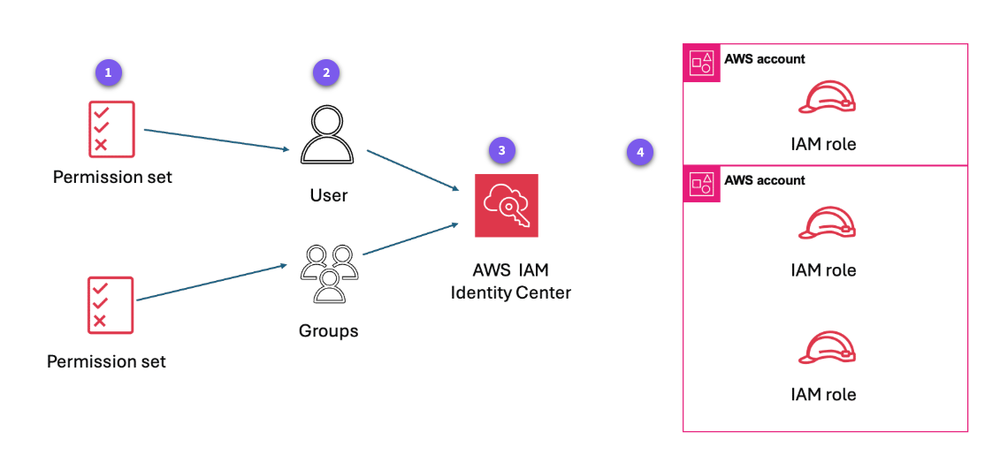

# IAM Identity Center

- On July 26, 2022, AWS Single Sign-On was renamed to AWS IAM Identity Center.
- AWS IAM Identity Center is a service that lets you centrally manage user identities and access to multiple AWS accounts and business applications using a single sign-on (SSO) experience.
- It is the recommended way to manage human users in AWS organizations.
- We can use both AWS IAM and AWS IAM Identity Center at the same time (You can still have IAM users in your AWS accounts even if IAM Identity Center is enabled.)

---

IAM Identity Center offers the following key features that enhance its functionality as a centralized access management solution:

- Single point of control for user authentication and authorization.
- Ability to provide single sign-on functionality
- Integration with other AWS services
- Streamlined onboarding and off-boarding / Scalable identity management
- MFA support
- Streamline compliance efforts by centralizing user access management and generating detailed access reports for auditing purposes.

---

## Considerations for choosing an AWS Region for IAM Identity Center

https://docs.aws.amazon.com/singlesignon/latest/userguide/identity-center-region-considerations.html

You can enable IAM Identity Center in a single, supported AWS Region of your choice and it is available to users globally. Following are key considerations for choosing an AWS Region.

- Geographical location of your users – When you select a Region that is geographically closest to the majority of your end users, they'll have lower latency of access to the AWS access portal and AWS managed applications, such as Amazon SageMaker AI.
- Opt-in Regions (Regions that are disabled by default) – An opt-in Region is an AWS Region that is disabled by default. To use an opt-in Region, you must enable it.
- Replicating IAM Identity Center to additional Regions – If you plan to replicate IAM Identity Center to additional AWS Regions, you must choose a Region enabled by default.
- Choosing deployment Regions for AWS managed applications – AWS managed applications can operate only in the AWS Regions in which they are available. Many AWS managed applications can also operate only in a Region where IAM Identity Center is enabled or replicated to (primary or additional Region).
- Digital sovereignty – Digital sovereignty regulations or company policies may mandate the use of a particular AWS Region. Consult with your company’s legal department.
- Identity source – If you’re using AWS Managed Microsoft AD or your self-managed directory in Active Directory (AD) as the identity source, its home Region must match the AWS Region in which you enabled IAM Identity Center.
- Cross-Region emails with Amazon Simple Email Service – In some Regions, IAM Identity Center may call Amazon Simple Email Service (Amazon SES) in a different Region to send email. In these cross-Region calls, IAM Identity Center sends certain user attributes to the other Region. For more information, see Cross-Region emails with Amazon SES.
- AWS Control Tower – If you’re enabling an organization instance of IAM Identity Center from AWS Control Tower, the instance will be created in the same Region as the AWS Control Tower landing zone.

---

## Benefits of multi-Region support

After replication IAM Identity Center automatically replicates workforce identities, permission sets, user and group assignments, sessions, and other metadata from the primary Region to the chosen additional Regions.

- Improved resiliency of AWS account access – Your workforce can access their AWS accounts even if the IAM Identity Center instance experiences a service disruption in its primary Region. This applies to access with permissions provisioned before the disruption.
- Enhanced flexibility in choosing deployment Regions for AWS managed applications – You can deploy AWS managed applications in your preferred Regions to meet application data residency requirements and improve performance through proximity to users. Applications deployed in additional Regions access replicated workforce identities locally for optimal performance and reliability.

---

## Architecture



1. Admins create permission sets in IAM Identity Center.
2. Users get assigned to permission sets in AWS accounts.
3. Users log in to IAM Identity Center and select their assigned permission set.
4. Users get credentials for IAM roles in their chosen or assigned AWS account.

---

## IAM Identity Center instance types

There are **two ways to create it**:

### 1. Organization instance — 🏢 Central AWS login

https://docs.aws.amazon.com/singlesignon/latest/userguide/organization-instances-identity-center.html?utm_source=chatgpt.com

This is the **recommended option**.

Imagine you have:

```text
AWS Organization
│
├── Account A
├── Account B
└── Account C
```

You create **one IAM Identity Center** in the **Organizations management account**:

```text
              IAM Identity Center
                      │
          ┌───────────┼───────────┐
          ↓           ↓           ↓
      Account A   Account B   Account C
```

Now you can centrally say:

> Kavindu → can access Account A as Developer
> Kavindu → can access Account B as Administrator
> Another user → can access Account C as ReadOnly

So you have **one place to manage users and their access to multiple AWS accounts**.

This is what you normally want for a company/production environment.

---

### 2. Account instance — 🏠 One AWS account only

An **account instance** belongs to **one specific AWS account**.

For example:

```text
AWS Account A
│
└── IAM Identity Center
```

It doesn't act as a central access-management system for your whole AWS Organization.

It's mainly intended for **isolated use of certain AWS applications**.

Use when you want to use IAM Identity Center only for an AWS-managed application, such as Kiro.

---

### The easiest way to remember

| Type                      | Think of it as                     | Main purpose                      |
| ------------------------- | ---------------------------------- | --------------------------------- |
| **Organization instance** | 🏢 Company-wide login system       | Manage access across AWS accounts |
| **Account instance**      | 🏠 Login system inside one account | Isolated AWS application use      |

---

## Add single sign-on (SSO) using Microsoft Entity Manager (Azure AD)

- Change identity source to **External identity provider**.
- create a Enterprise application in Azure AD.
- Add the **AWS IAM Identity Center** application to Azure AD.

### System for Cross-domain Identity Management (SCIM)

- SCIM is an open standard that allows you to automate the exchange of user identity information between identity domains or IT systems.
- It is used to automatically provision and de-provision users in AWS IAM Identity Center from Azure AD.

---

## Applications in IAM Identity Center

- Applications are applications that your users can access through the same IAM Identity Center login.
- "After a user logs into IAM Identity Center, what other applications can they open?"

```
Microsoft Entra ID
       ↓
IAM Identity Center
       ↓
   User logs in
       ↓
 ┌───────────────┐
 │ AWS Accounts  │
 │ Salesforce    │
 │ Slack         │
 │ GitHub        │
 │ Other apps    │
 └───────────────┘
```

- The Applications section is mainly for giving users SSO access to applications outside AWS.

---

resources:

- https://www.youtube.com/watch?v=iSCuTJNeN6c

```

```
