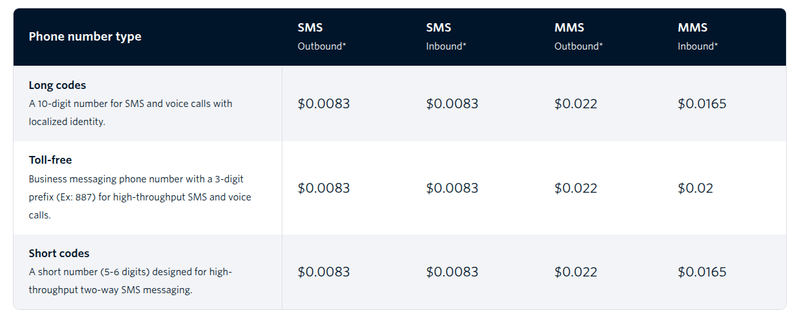
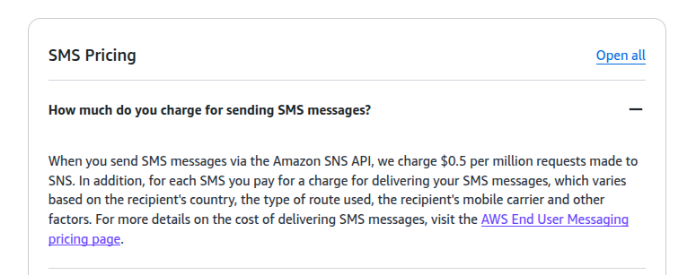
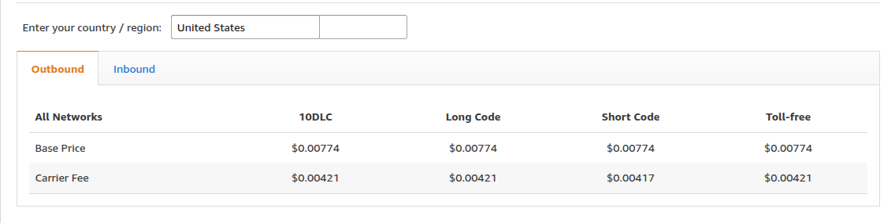
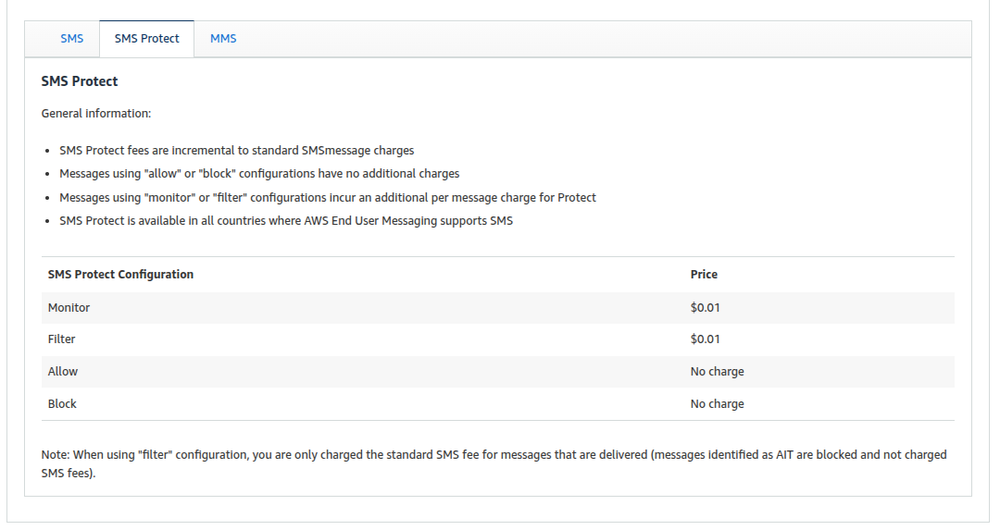

# AWS SNS and Twilio comparison

- AWS SNS do not provide whatsapp messaging service, but Twilio does.
- However, AWS supports WhatsApp messaging through a separate service called AWS End User Messaging Social

In here we only focus on sending messages only, not receiving messages.

- Below pricing based on US region.

## SMS

### Twilio

- Prices may change from country to country, and the prices below are for the US region.
- one inbound sms message price - $0.0083
- 1 million outbound sms messages price - $0.0083 \* 1,000,000 = $8,300

- we also need to pay for carrier fees, i have chosen AT&T as the carrier, which is $0.0035 per message.
- 1 million outbound sms messages carrier fees - $0.0035 \* 1,000,000 = $3,500

- So the total cost for 1 million outbound sms messages is $8,300 + $3,500 = $11,800

- url : https://www.twilio.com/en-us/sms/pricing/us

### SNS

- url : https://aws.amazon.com/sns/pricing/ (go to Worldwide SMS)
- Amazon SNS also offers scalable SMS (text) messaging to 200+ countries leveraging AWS End User Messaging
- The price for sending SMS messages varies by destination country. In some cases, the price also includes a telecom carrier fee for the destination phone number.
- protect SMS from artificially inflated traffic
- we charge $0.5 per million requests made to SNS.
- first 1 million requests per month are free, and each next million requests are $0.5 per million requests.

- one inbound sms message price - $0.00774
- 1 million outbound sms messages price - $0.00774 \* 1,000,000 = $7,740
- Carrier fee for long code, Toll-free number is $0.00421. For Short Code is $0.00417
- So for 1 million outbound sms messages, the total cost is $7,740 + $4,210 = $11,950

- https://aws.amazon.com/end-user-messaging/pricing/

- SNS also provide SMS protection

---

## WhatsApp

### Twilio

- WhatsApp pricing is calculated based on Twilio’s per-message fee, plus Meta’s per-template message fee, which Twilio passes through to customers.
- Twilio’s per-message fee for WhatsApp is $0.005, inbound or outbound.
- Pay Meta’s template fees for Marketing, Utility, Authentication, Service messages
- Meta fees vary by message category and destination country.
- We are focusing on utility, authentication messages. Also we only considering messages outside the customer service window
- https://www.twilio.com/en-us/whatsapp/pricing

#### Utility messages

- For utility messages, the Meta template fee ($0.0034) is only applied if the message in outside the customer service window. If the message is sent within the customer service window, the Meta template fee is $0.00, and you only pay Twilio’s flat $0.005 handling fee.
- Lets calculate the cost for 1 million outbound utility messages outside the customer service window.
- $0.005 + $0.0034 = $0.0084
- $0.0084 \* 1,000,000 = $8,400

#### Authentication messages

- For authentication messages, the Meta template fee ($0.0034) is always applied because we are always sending authentication messages outside the customer service window. So the total cost for 1 million outbound authentication messages is $0.005 + $0.0034 = $0.0084 per message.
- $0.005 + $0.0034 = $0.0084
- $0.0084 \* 1,000,000 = $8,400

### AWS END USER MESSAGING

- you use AWS End User Messaging directly via its API or SDK to send outbound WhatsApp messages. You do not need to send them through Amazon SNS.
- AWS message fee: $0.005 per outbound message globally (except India Authentication and Utility messages at $0.002), and $0.001 per inbound message globally.
- Meta message fee: price varies for each country and message type.
- url: https://aws.amazon.com/end-user-messaging/pricing/
- here also we have focus on utility, authentication messages. There is no customer service window concept in SNS

#### Utility messages

- For utility messages, the Meta template fee ($0.0026).
- So lets calculate the cost for 1 million outbound utility messages
- Meta gives you a discount on the applicable message rate (750,001–2,250,000 - $0.0023 - 10%)
- $0.005 + $0.0023 = $0.0073
- $0.0073 \* 1,000,000 = $7,300

#### Authentication messages

- For utility messages, the Meta template fee ($0.0026).
- So lets calculate the cost for 1 million outbound utility messages
- Meta gives you a discount on the applicable message rate (750,001–2,250,000 - $0.0023 - 10%)
- $0.005 + $0.0023 = $0.0073
- $0.0073 \* 1,000,000 = $7,300

---

---

### sns vs AWS End User Messaging

- When comparing Amazon SNS (Simple Notification Service) and AWS End User Messaging, the most important thing to understand is that they are no longer completely separate, competing tools. Instead, AWS End User Messaging acts as the underlying delivery infrastructure for end-user communications across the AWS ecosystem.
- When you use Amazon SNS to send an SMS message directly to a phone number, the request actually routes through the AWS End User Messaging SMS backend to handle the final delivery.
- The actual base cost to deliver an SMS is exactly the same.
